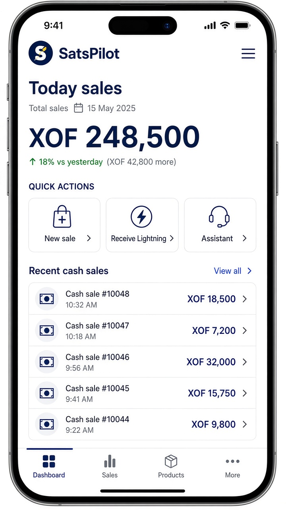
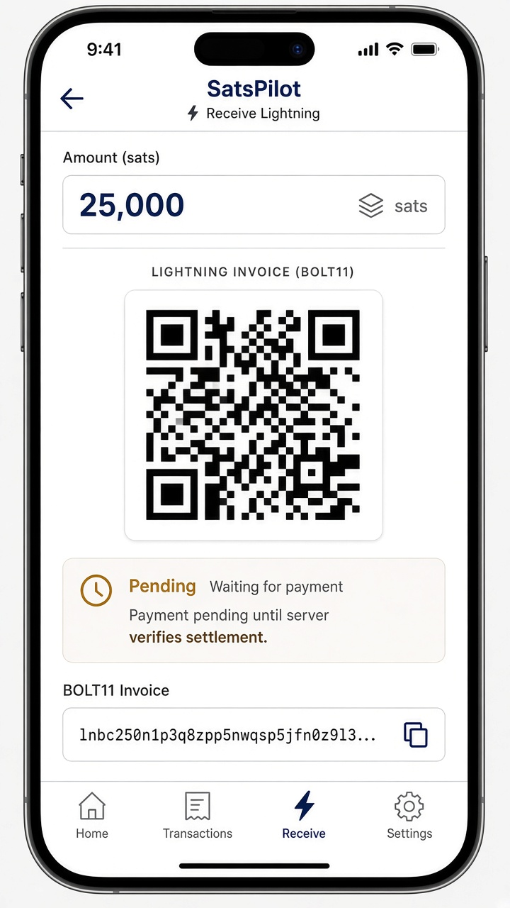
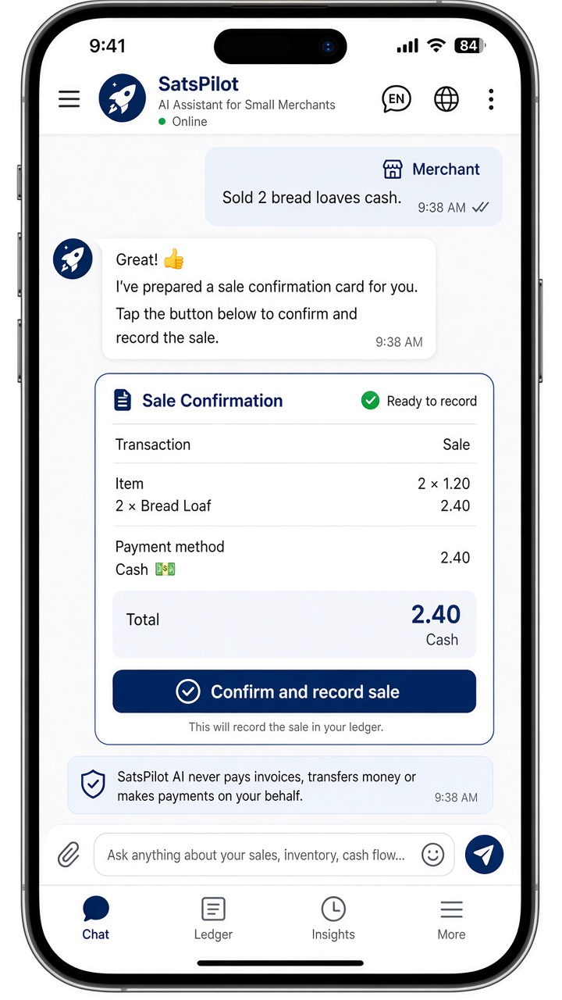
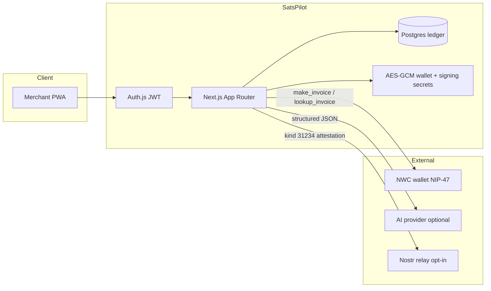

# SatsPilot

**Open-source AI-powered Bitcoin Lightning business assistant for small merchants.**

Record sales on a phone, accept Lightning via **Nostr Wallet Connect (NIP-47)**, issue privacy-preserving **signed receipts**, and ask an AI about *your* ledger — in **English and French**.

[MIT License](./LICENSE) · [Demo script](./docs/demo-script.md) · [Security review](./docs/security-review.md) · [Devpost pitch](./docs/submission.md)

---

## Problem

Neighborhood shops and kiosks still run on cash notebooks. Lightning wallets are on phones, but merchants lack a **simple, secure** console that:

- records sales and customer tabs without inventing exchange rates  
- receives sats without handing an AI (or a browser) spend permission  
- proves a receipt without publishing customer names to the world  

## Target merchant

A mid-range Android user running a small shop (e.g. market stall / *boutique de quartier*) who needs French or English, low bandwidth, and trustworthy payment status — never a false “paid.”

## Solution

SatsPilot is a progressive web app + Postgres backend:

| Capability | Behavior |
| --- | --- |
| Bookkeeping | Cash/credit sales, expenses, balances — integer minor units |
| Lightning | Server-side NWC `make_invoice` + `lookup_invoice` only |
| Settlement | Sale marked paid only after verified provider settlement |
| Receipts | Canonical hash + Nostr signature; public verify without PII |
| AI | Ledger Q&A + sale *suggestions*; confirm required to write |

## Features

- Mobile-first merchant console (≈360px) with EN/FR dictionaries  
- Auth.js sessions + merchant membership authorization on every scoped query  
- NWC credentials encrypted at rest (AES-256-GCM); never returned after connect  
- Invoice QR / BOLT11, resume after reload, restart-safe reconciliation  
- AI provider configurable (`none` / `mock` / OpenAI-compatible) with Zod allowlists  
- Optional opt-in Nostr relay publish of minimal attestation events  
- Installable PWA (static assets only — no wallet secrets cached)  

## Screenshots

Illustrative UI frames (product mockups — not proof of live mainnet payments):

| Dashboard | Receive Lightning | AI assistant |
| --- | --- | --- |
|  |  |  |

Capture real device shots after `npm run demo` if needed for your submission gallery.

## Architecture



Details: [docs/architecture.md](./docs/architecture.md) · Threat model: [docs/threat-model.md](./docs/threat-model.md)

## Stack

- **App:** Next.js 16 (App Router), React 19, TypeScript  
- **UI:** Tailwind CSS v4, accessible mobile console  
- **Data:** PostgreSQL 16 + Prisma 6  
- **Auth:** Auth.js (Credentials + JWT)  
- **Lightning:** `@getalby/sdk` NWCClient (server-side)  
- **Nostr:** `nostr-tools` (receipt attestations)  
- **AI:** OpenAI-compatible HTTP API (optional)  
- **Ops:** Docker Compose, GitHub Actions CI  

## Quick start (one command)

**Requires Docker Desktop** (Compose).

```bash
git clone <this-repo> satspilot
cd satspilot
npm run demo
```

Open [http://localhost:3000](http://localhost:3000).

| Demo login | Value |
| --- | --- |
| Email | `merchant.demo@satspilot.local` |
| Password | `DemoMerchant1!` |

Compose defaults use **`LIGHTNING_PROVIDER=mock`** so invoice settlement is reproducible for judges **without** real wallet credentials. The product UI labels demo mode. Live NWC is supported — see outstanding manual test below.

Stop: `npm run demo:down`

### Fresh clone without Docker

```bash
cp .env.example .env.local
# set AUTH_SECRET and WALLET_ENCRYPTION_KEY (commands in .env.example)
# start PostgreSQL 16 and match DATABASE_URL
npm install
npx prisma migrate deploy
npm run db:seed
npm run dev
```

### Useful scripts

| Script | Purpose |
| --- | --- |
| `npm run demo` | Compose up: Postgres + migrate + seed + app |
| `npm run dev` | Next.js development server |
| `npm run build` / `npm start` | Production build & serve |
| `npm test` | Vitest unit/security tests |
| `npm run test:e2e` | Playwright happy-path |
| `npm run lint` / `npm run typecheck` | Quality gates |
| `npm run db:setup` | `migrate deploy` + seed |

## Demo data

Seed creates **fictitious** merchant **Marché Keur Demo** (Dakar), products, customers, cash/credit sales, and an encrypted **placeholder** wallet row (not a real NWC URI).  

Seed is blocked in production unless `APP_ENV=demo` or `ALLOW_DEMO_SEED=true`.

## Lightning status

| Mode | How | Settlement |
| --- | --- | --- |
| **Mock (demo)** | `LIGHTNING_PROVIDER=mock` or `mock://…` URI | Deterministic; labeled demo — **not** a live payment |
| **Live NWC** | Receive-only NWC URI in Settings | Real `make_invoice` / `lookup_invoice` |

**Outstanding manual test:** live two-wallet payment verification requires your own NWC credentials. Exact procedure: [docs/lightning-nwc-manual-test.md](./docs/lightning-nwc-manual-test.md). Do not claim a successful live payment until that checklist is recorded.

## AI status

Works with `AI_PROVIDER=none` (heuristic / ledger fallbacks) or a configured OpenAI-compatible key. The model **cannot** pay invoices or save sales without an explicit merchant confirm action.

## Documentation

| Doc | Contents |
| --- | --- |
| [docs/demo-script.md](./docs/demo-script.md) | Timed 3-minute judge demo |
| [docs/submission.md](./docs/submission.md) | Devpost-ready pitch |
| [docs/impact.md](./docs/impact.md) | Measured results vs projections |
| [docs/deployment.md](./docs/deployment.md) | Deploy & env reference |
| [docs/security-review.md](./docs/security-review.md) | Security audit findings |
| [docs/architecture.md](./docs/architecture.md) | Modules & invariants |
| [docs/test-results.md](./docs/test-results.md) | Captured test output |
| [docs/hackathon-checklist.md](./docs/hackathon-checklist.md) | Submission checklist |

## Limitations

- Live Lightning not verified in CI (needs wallets)  
- CSP allows `'unsafe-inline'` / `'unsafe-eval'` (Next.js constraint)  
- Rate limits are in-process (not multi-instance)  
- Signing / NWC keys are software-encrypted (no HSM)  
- No invented XOF↔sats FX in the ledger  

## Roadmap

1. Field pilot with 5–10 shops (see impact metrics)  
2. Hardened multi-instance rate limiting  
3. Stricter CSP where Next allows  
4. Automated signing-key rotation  
5. Broader Lightning UX (expiry, refunds policy docs)  

## Security highlights

- Merchant ID in the URL is never sufficient — membership re-checked server-side  
- NWC secrets redacted from API DTOs and logs  
- Settlement claim is idempotent; client cannot force “paid”  
- AI forbidden actions include `pay_invoice` and secret exfiltration  

Full write-up: [docs/security-review.md](./docs/security-review.md)

## License

[MIT](./LICENSE) — Copyright (c) 2026 SatsPilot contributors
